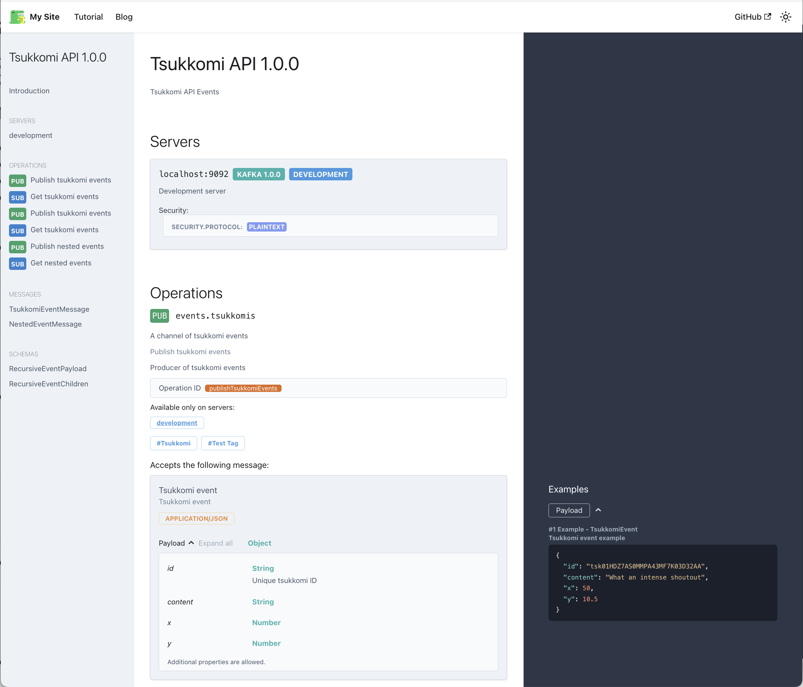

# docusaurus-asyncapi

[](https://badge.fury.io/js/docusaurus-asyncapi)

Async API Documentation for Docusaurus V3.

[Live example](https://mtso.github.io/docusaurus-asyncapi/) · [AsyncAPI reference](https://mtso.github.io/docusaurus-asyncapi/api/)



## Installation

```
npm install docusaurus-asyncapi
```

### Dependency security with Docusaurus 3.10.2

Docusaurus 3.10.2 can install vulnerable versions of `tinypool` and
`serialize-javascript` in its Node build tooling. To select patched versions,
merge the following into your **site application's root `package.json`**, keeping
any existing overrides:

```json
{
  "overrides": {
    "tinypool": "^2.1.2",
    "serialize-javascript": "^7.0.5"
  }
}
```

- `tinypool` addresses the critical prototype-pollution gadgets in
  [worker options](https://github.com/advisories/GHSA-5gmw-xhrv-c9v3) and
  [`run()` options](https://github.com/advisories/GHSA-85c8-ppgw-ccpr).
- `serialize-javascript` addresses the high-severity
  [code-injection advisory](https://github.com/advisories/GHSA-5c6j-r48x-rmvq).

This repository applies these overrides for its own builds. Installing
`docusaurus-asyncapi` does not apply them to your site:
[npm only honors overrides in the application's root package.json](https://docs.npmjs.com/cli/v11/configuring-npm/package-json/#overrides),
and this repository's lockfile does not control your installed dependency versions.
For an npm workspace, put the overrides in the workspace root.

After merging the overrides, run these commands from your application's root:

```sh
npm install
npm audit
npm run build
```

Commit the updated `package.json` and `package-lock.json`. These overrides were
tested with Docusaurus 3.10.2 on Node 20.19.5, including its production build and
optional SSG workers. Verify your own site's audit and build after installing.
Remove each override once your Docusaurus toolchain selects a patched version
without it, then reinstall and repeat those checks.

The overrides do not clear every audit finding. As of October 19, 2026,
[`braces` through 3.0.3 has an unresolved high-severity denial-of-service advisory](https://github.com/advisories/GHSA-vfj7-8cjw-p6xm)
with no published patch. It appears through multiple Docusaurus build/watch
dependencies, so one advisory can produce several high audit entries. Deeply
nested, attacker-controlled glob patterns can crash the Node process; keep build
configuration and glob patterns under maintainer control. Moderate findings may
also remain, and `npm audit` can still exit nonzero after applying the overrides.
The worker pool and asset serializer run in Node during the build; they are not
part of the static site's browser runtime.

See the [security policy](https://github.com/mtso/docusaurus-asyncapi/blob/main/SECURITY.md)
for supported versions, private vulnerability reporting, and the full dependency
audit record.

## Usage

```js
// docusaurus.config.js

const config = {
  presets: [
    [
      "docusaurus-asyncapi",
      {
        specs: [
          {
            spec: "path/to/asyncapi.yml",
            route: "/asyncapi",
          },
        ],
        // See defaults for ConfigInterface at:
        // https://github.com/asyncapi/asyncapi-react/blob/42a349ad/library/src/config/default.ts#L7
        config: {
          show: {
            sidebar: true,
          },
        },
      },
    ],
    ...
  ],
  ...
}

module.exports = config;
```

## Local Development

### Requirements

- node >=v20

### Building Example

```
npm ci
npm run build --workspaces
cd example
npm start
```

This builds the packages and starts the local docusaurus server.
